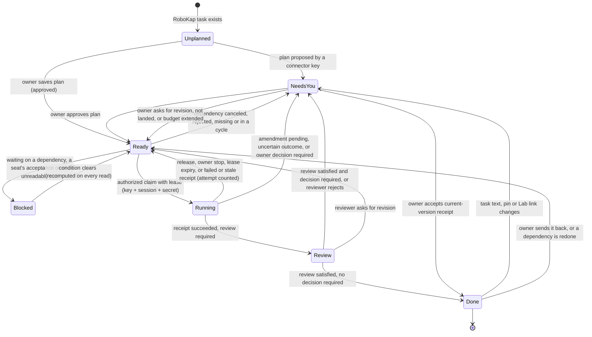
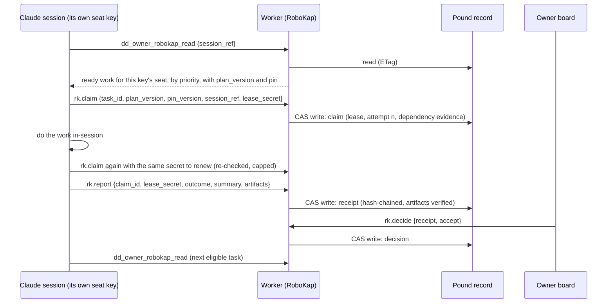
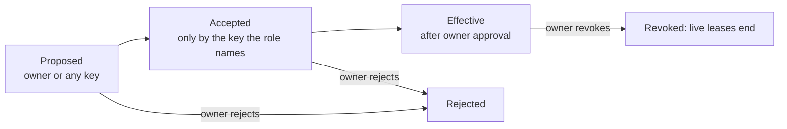
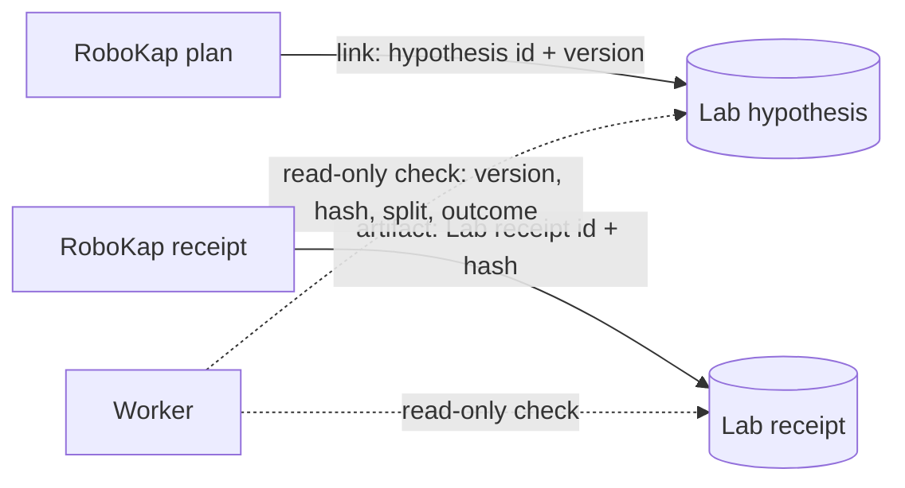

# RoboKap coordination layer

> **Update 2026-10-30.** The product is now called Pack Sled in everything people see; internal
> names (`robokap`, `/robokap/v1`, `dd_owner_robokap_*`, storage keys) are unchanged. Playbooks,
> deduplicated intake, dispatch, heartbeats, claim-level evidence, review checks, notices and a
> resumable runner are described in [pack-sled-team.md](pack-sled-team.md). Statements below
> about the flag and deployment describe the original build and may be out of date.

RoboKap now has a coordination layer: an owner-approved work graph over existing RoboKap tasks,
with seat roles, leased claims, version-bound receipts, typed reviews and owner decisions, a
mobile owner board, and one pull transport to an assistant session through the existing
connector. **It is off by default** (`ROBOKAP_ENABLED="false"`). Nothing here was deployed,
switched on, connected to a live session, or used to send a Discord message.

Source: `research-lab/robokap-core.mjs` (pure rules), `research-lab/robokap.mjs` (Worker
integration), `research-lab/robokap.html` + `robokap-board.mjs` + `robokap.css` (owner board).
Discord is an interface to this harness, not the harness; see [Discord](#discord).

## What is built, tested, connected and running

| | State |
|---|---|
| Built | Core rules, Worker route `/robokap/v1`, connector tools `dd_owner_robokap_read/write`, owner board page, default-off flag |
| Tested | Synthetic only: core acceptance suite, connector/route integration, packaged Worker in Miniflare, board in Chromium against the real route handler |
| Connected | No live session. The transport is the existing owner connector; the pilot below needs approval |
| Running | Nothing. No Worker deploy, flag change, credential, grant, schedule or Discord call was made |

## Where records live and who owns them

| Record | Store | Owner | RoboKap does |
|---|---|---|---|
| Tasks, messages, context versions | Pound record `/privatePounds/<owner>` → `payload` | Pound | Reads tasks and context hashes. Never rewrites them |
| Pins, plans, roles, claims, receipts, reviews, decisions, events | Same Pound record → `robokap` key (JSON string) | RoboKap | Appends; amendments add versions, history is kept |
| Hypotheses, experiments, Lab receipts, findings | Lab tenant `/researchLab/v1/tenants/<tenant>` | Lab | Reads versions, receipt hashes, splits and run outcomes through the owner's research access. Never writes, claims or runs |
| Project milestones, checks, decisions, roles | Project store (`RESEARCH_PROJECTS_ENABLED=false`) | Project store | Untouched. Plan acceptance items may carry a `check_ref` link only |
| Discord requests and threads | `/discord_pack_v1` (PR #332, draft) | Discord seats | Accepts a `discord_message` receipt artifact and checks it against the plan's thread |

One record, one ETag compare-and-swap: every existing Pound writer (owner session, owner
connector, delegated gateway, portraits, agent setup) spreads the envelope, so neither side can
erase the other. The nightly private backup already copies the whole record (30-day private
copy) and keeps it out of general backups. There is no second task store.

## Identity and trust

| Principal | How it is established | May |
|---|---|---|
| Owner session | Signed site session of `RESEARCH_OWNER_UID` | Pin, plan (approved), decide, stop any lease, do owner-seat tasks |
| Owner connector key | Connector credential; `key_label` server-verified (`primary`, per-assistant labels) | Propose plans and roles, accept a role naming its own key, claim/renew/release/report for its seat, advisory review |
| Delegated agent | Separate `da1_` credential (designed in `AGENT-CONNECTIONS.md`) | Modelled for independent review; **not wired to RoboKap** |
| Declared by the session | `session_ref`, summaries, notes, model names | Routing and display only. Never authorization |

Every connector key carries owner authority, so a key label proves which key acted, not which
model. Reviews from connector keys are recorded as `advisory` and can never satisfy an
`independent` requirement. A self-reported sign-up is a role *proposal*; acceptance must come
from the key the role names; approval is a separate owner decision.

- **The shared `primary` key never holds a seat** (`shared_primary_key_not_allowed`): every
  client holding it looks the same. The Worker also refuses to add a labelled key named
  `primary`, so that name always means the original key. (A labelled key named `Primary` created
  before this change keeps working as a connector key, but cannot hold a seat either.)
- **A role binds to a key label.** Re-adding a label (rotating that key) gives the new secret the
  same seat. Removing the key or revoking the role cuts the seat off.
- **Session targeting** (`session_ref`) stops accidental cross-session claims. It is declared by
  the session, so it does not stop a key holder who deliberately claims to be another session.

## Process maps

### Task lifecycle



A dependent task is eligible only when each dependency is **Done at its current version**:
a current receipt for the approved plan version, the pinned context version still current, the
task text unchanged since approval, the required review satisfied and, where required, the
owner's accept decision.

Dependencies are the plan's `depends_on`, the Pound blockers in force when you approved the
plan, and every task whose Pound `blocks` list names this one now.

- Adding a Pound blocker takes effect at once.
- Removing a blocker that an approved plan recorded changes nothing until you approve a new plan
  version, so a connector key cannot unblock work by editing Pound. Before you approve an
  amendment, the board lists any dependency the approval would stop enforcing.
- A blocker added after approval is shown as a live Pound edge. Until a plan version records it,
  any Pound writer can remove it again.
- An archived task blocks nothing new; an archived recorded dependency sends the task to Needs You.
- A dependency that is canceled, rejected, missing or in a cycle goes to Needs You. A dependency
  that is simply not done yet leaves the task Blocked.
- A result binds to the dependency evidence it started from. If a dependency is redone after the
  dependent was accepted, the dependent reopens for a new attempt.
- Canceling is yours in both directions: Pound already let only you cancel a task, and now only
  you can reopen one, so a connector key cannot revive a canceled dependency.

Approvals bind to what you saw. Each card carries a `basis` (the task text and the Pound
blockers an approval would record). Approving a proposal must send it, and the board also sends
it with your own plan saves; if either changed after the board loaded, the write is refused
(`plan_basis_changed`) and you review the fresh card instead.

### Claim, execute, report



Stop conditions, all enforced by the server: stale plan, pin or task text; wrong key, session
or lease secret; a live lease held by another session; an unreconciled uncertain outcome; a
pending owner decision; a failed, canceled or missing dependency; a dependency cycle; exhausted
attempts; an unverifiable or stale Lab link; a revoked role or expired connector grant.

Leases:

- **Renewal** re-checks the task text, pin, Lab link and dependencies, and stops at four lease
  lengths after the claim (`max_expires_at`). A lease whose context changed is flagged on the
  board, cannot renew, and its result is recorded as stale.
- **Late results.** A report after the lease ended is kept (labelled late) if no newer attempt
  started; otherwise it is refused. An `uncertain` outcome is always recorded, so the owner can
  reconcile it.
- **Superseded or stopped leases.** A result from a lease ended by an approved amendment, a role
  revocation or your stop is recorded as stale and never counts.
- **Uncertain outcomes** from any plan version block retries until you record whether they
  landed. An amendment cannot erase one, archiving or deleting the task does not hide one (it
  stays in Needs You), and one is always recordable: it skips the connector share of the store
  and is accepted even after the seat released its own lease.
- **Renewal** extends to one lease length from now, never past the ceiling; only a lease already
  at its ceiling is refused (`lease_limit_reached`).
- **Stopping a lease** ends that attempt; the seat may claim again as a new attempt. To keep a
  seat off a task, revoke its role or amend the plan.

Reviews and decisions:

- One review per key per result. A reviewer's revise or reject closes review: later accepts
  cannot outvote it, and you cannot accept over it (amend the plan to change the requirement).
- One open proposal per task. A key may replace its own open proposal (the replaced one leaves no
  record); another key's proposal waits until you approve or reject the open one. Proposals you
  reject or replace with your own plan keep a fingerprint (`content_sha256`), not their text;
  approved versions are kept in full.
- You can send back accepted work even when its plan needed no decision.
- Each decision keeps its own id and records what it decides as `subject_id`.

### Roles



### Pound–Lab contract



- The Lab stays authoritative. RoboKap stores references and checks them read-only.
- Saving or claiming a coordination task never launches an experiment or grants access.
- A Lab receipt counts as evidence only if its hash matches and it belongs to the linked
  hypothesis version. Plans can require it (`lab.evidence: "required"`); a required receipt must
  have executed and not failed (null and inconclusive results count). The requirement applies
  when a result is accepted, so an `uncertain` report reconciled as landed still needs one.
- A Lab receipt is matched by hypothesis version, not bound to the attempt that cites it.
- Lab references are verified when recorded: while the Lab cannot be read, a report citing one
  is refused (`lab_unavailable`) and can be resent later.
- A revised or withdrawn hypothesis makes the link stale; an unreadable Lab blocks linked work.
- The 2025 holdout stays sealed: `data_scope` has no holdout value, and Lab receipts are
  accepted only from the `discovery` or `development` splits.

## Agent protocol (connector)

1. `dd_owner_robokap_read {session_ref}`: role offers, ready work (highest priority first), your
   live leases, review requests.
2. `rk.role.accept {role_id}` for a role naming your key.
3. `rk.claim` with the read's `plan_version` (and `pin_version`), your `session_ref` and a fresh
   random `lease_secret`. Resend the same values to renew before expiry, until `max_expires_at`.
4. Do the work. `rk.report` with `succeeded`, `failed` or `uncertain` (an external effect may or
   may not have landed), a summary and artifact references.
5. Read again for the next eligible task. Stop when nothing is ready.

After a timeout, resend the identical request (same `request_id`) promptly: replies are kept for
the last 256 writes, after which a resend is treated as new and checked again. When the window is
full, the oldest reply of whoever holds the most is dropped first, so one busy key cannot push out
yours. If the request id is lost, read first and reconcile; never claim again blindly.

Artifact verification is shown per artifact: `server_verified` (RoboKap context version or Lab
receipt matched), `format_checked` (GitHub commit/PR, Claude artifact, Discord message, https
URL) or `claimed` (a note).

## Pack capability matrix

| Seat | Read shared context | Receive a task | Wake a session | Execute | Independent review |
|---|---|---|---|---|---|
| Claude | Supported via its own connector key | Supported by pull | Unsupported | In-session only | No (shared owner authority) |
| Grok, Gemini, Muse | Same mechanism if their client holds its own key; not verified end to end | Same | Unsupported | In-session only | No (shared owner authority) |
| Scout/dot | No connection established | Manual | Unsupported | Manual | No |
| Delegated agent | Designed, not wired to RoboKap | — | — | — | Yes, by design |

"Unsupported" means nothing here can start or wake an assistant: the owner opens the session
and asks it to check its queue. Scheduled runs start fresh sessions, not existing ones, and are
not substituted for an existing conversation.

## Discord

PR #332 (draft) supplies Discord seat routing: `/pack to:<seat>`, one bound session per seat,
labelled replies and Discord API receipts. It reuses the `/ask` interaction intake and the
thread-delivery and uncertain-send handling from `docs/discord-inbound.md`. RoboKap does not
modify it. The contract between them is:

- A plan may name a Discord thread (`thread.discord_thread_id`).
- A seat that answers a RoboKap task in Discord reports the delivered message URL from its
  `dd_pack_answer` receipt as a `discord_message` artifact; RoboKap refuses one from another thread.
- A follow-up after #332 merges can add a typed `task:` option to `/pack` so the request carries
  the task id and plan version. A queued request, a pong or a format-checked URL is not proof of
  a round trip; the pilot's Discord leg needs #332's own seat acceptance test.

## Reconciliation with recent work

- #327 (merged): Lab lease ownership and receipt verification. RoboKap mirrors its rules
  (reconcile before retry, verify linkage and hashes before showing completion) for Pound work.
- #330 (draft, paused): bounded foreground Lab continuation. Not merged, not superseded:
  RoboKap verifies Lab receipts however they were produced and does not depend on it.
- #331 (merged): read-only Worker inventory. Use it to confirm the active version before and
  after any RoboKap release.
- #332 (draft): Discord seats; see above.

## Activation bundle

Requires your explicit approval, in this order. Nothing below has been done.

1. **Review and merge** this PR. Pages then publishes the board page; it is inert while the
   Worker flag is off.
2. **Isolated release:** build the Worker from the production commit plus this change, not from
   `main` (which carries other Worker changes merged since the last deploy), and run the packaged
   tests on that exact artifact before deploying it.
3. **Deploy with `ROBOKAP_ENABLED="false"`**, then confirm the active version with the
   `worker-inspect` workflow. RoboKap stays off. Two small behaviour changes ship with it:
   `/auth/mcp-token` refuses to add a new labelled key named `primary` (existing keys untouched),
   and only the owner can reopen a canceled Pound task.
4. **Flip `ROBOKAP_ENABLED` to `"true"`** and deploy.

| Item | Detail |
|---|---|
| Permissions | Route `/robokap/v1` for the configured owner's signed session. Two connector tools for the owner's connector keys while the RoboKap app grant is on. Keys gain proposals, own-key role acceptance, claims/reports for their own seat and advisory reviews; never pins, decisions, Lab writes or grants. Keys can fill at most three quarters of each record list and of the 256 KiB store, so you always have room to decide. No new credential, secret, grant, binding or schedule |
| Data recipients | Firebase RTDB (existing Pound record). Cloudflare (Worker; existing 30-day private KV backup of the same record). Each assistant provider whose session reads its queue receives those task briefs and pins (Anthropic for Claude; xAI, Google or Meta only if their keys read). Nothing goes to Discord or GitHub from RoboKap |
| Costs | No new paid service. Per call: one Pound read, one read-only Lab read, at most one write plus compare-and-swap retries. Assistant usage is the session's own plan; no API billing |
| Stop controls | Stop any lease from its card. Revoke the seat role on the board (live leases end). Turn off the RoboKap app grant on App permissions (tools disappear for every key). Set `ROBOKAP_ENABLED="false"` and deploy, or roll back the Worker version. Plan budgets cap attempts and lease minutes. Closing the session stops all work: nothing runs without it |
| Rollback | Worker: previous version via the deploy workflow, or the flag off. Data: records stay inert in the `robokap` key; deleting that key is optional and only by your admin access. Pages: revert the merge commit |

## Proposed real-session pilot (separate approval)

- **Session:** one named existing Claude session holding a dedicated Claude connector key,
  recorded as the plan's target `session_ref`. Seats never use the shared `primary` key, so
  creating that key (a new credential) is the pilot's first approval.
- **Work:** two tasks you create in RoboKap. A: read the pinned design of record (pinned by
  exact revision, status draft) and save a short summary as a RoboKap context version. B,
  depending on A: list the open questions A's summary raises, as a task message.
  `data_scope: none`; no competition data, no Lab access.
- **Observable receipts:** the board's lane changes; A's receipt with a `server_verified`
  context-version artifact and its hash; the event log with the Claude seat key and declared
  session; your accept decision; B moving from Blocked to Ready without anyone relaying it.
- **Stop:** stop the lease or revoke the role on the board, or turn the app grant off; the plans'
  budgets cap attempts at 2.

## Limits and known gaps

- Lifetime caps per workspace (for example 300 claims, 200 receipts) with fail-closed capacity
  errors. A retention or archive policy is a later owner decision.
- RoboKap keeps its own event ring (200) and idempotency ring (256). Pound's 40-task and
  100-message lifetime limits still apply.
- Task briefs, summaries and artifacts are untrusted text, rendered as text.
- Claude Doc revisions are recorded as owner attestations: the Worker cannot read Claude Docs.
- No delegated-agent transport for RoboKap yet, so `independent` reviews cannot be satisfied in
  production until one is approved and wired.
- The board is not yet linked from the RoboKap workspace header; that is a sitewide navigation edit.

## Tests

```
node --test research-lab/robokap-core.test.mjs research-lab/robokap.test.mjs research-lab/pack-sled.test.mjs
DD_NODE_MODULES=<node_modules with miniflare> node --test research-lab/robokap-worker.test.mjs
DD_NODE_MODULES=<node_modules with playwright> node research-lab/robokap-browser.test.mjs
node work/test-identity-league-foundation.mjs
```

All fixtures are synthetic: invented tasks, keys, sessions, hypotheses and receipts.
